# Preferences review: the Folderstorm pages

A UI/UX review of the Folderstorm settings in Preferences, with options for
**Layouts and workspaces** (the part the human finds weakest) and smaller
proposals for the rest. Design only: no viewer code changes.

- Reviewed: `claude/test-all-2026-11-17b` at `419fc014` (all open PRs
  merged), the branch the human tests.
- Yardstick: upstream's interface rules (`AGENTS.md` § 7,
  `docs/BRANDING.md`) and the way upstream pages are built with `Cx`
  (`crates/aurora-viewer/src/ui/options/cx.rs`).
- Screenshots: real captures from demo mode (Xvfb + lavapipe,
  `AURORA_CAPTURE`). To show a whole tab in one picture, the Preferences
  window was made taller by a local patch that was never committed
  (`FS_REVIEW_PREFS_H`, the 720 px default height replaced). Everything
  else is the viewer as built.
- Mockups: static HTML/CSS that imitates the egui look, rendered with
  Playwright at 2× (`preferences-review/mockups/`). Their colours are
  sampled from the captures, not taken from the `Palette`.

Contents: [1. Where the Folderstorm settings are](#1-where-the-folderstorm-settings-are-today) ·
[2. Findings](#2-findings) · [3. Layouts and workspaces: options](#3-layouts-and-workspaces-three-options) ·
[4. Smaller proposals](#4-smaller-proposals-for-the-other-pages) ·
[5. Proposed order](#5-proposed-order-and-grouping) ·
[6. Recommendation](#6-recommendation) · [7. How the pictures were made](#7-how-the-pictures-were-made)

---

## 1. Where the Folderstorm settings are today

There is no Folderstorm section in the sidebar: every Folderstorm group is
hooked into an upstream page.

| Place in Preferences | Folderstorm content | Code |
|---|---|---|
| Interface › Layout › **Bars and windows** (top of the tab) | *World viewport*, *Background around the world*, *Desktop in the margins* (with the taskbar) | `pages/layout.rs:11` → `pages/folderstorm_viewport.rs`, `folderstorm_viewport/background.rs`, `folderstorm_viewport/desktop.rs` |
| Interface › Layout › **Layouts & workspaces** (4th tab) | *Saved layouts*, *Save the current arrangement*, *Arrangement*, *Saved workspaces*, *Quick switch* | `pages/layout.rs:188`, `pages.rs:90` → `pages/folderstorm_workspaces.rs`, `folderstorm_workspaces/workspaces_group.rs` |
| World › Graphics › **Smoothness** | *Other Folderstorm2 windows* (3D behind another window, its frame rate, shared cache) | `pages/graphics.rs:87` → `pages/folderstorm_characters.rs` |
| Communication › Chat › **Nearby chat** (end of the tab) | *Image uploads* | `pages/chat.rs:264` → `pages/folderstorm_chat_upload.rs` |
| Communication › **Privacy** (end of the page) | *Local assistant* (switch, 17 permission rows, status, activity, setup) | `pages/privacy.rs:308` → `pages/local_assistant.rs` |
| Interface › **Inventory** | *Wear in the context menu* (outfit safety), one row among upstream's | `pages/inventory.rs:56` |
| Controls › **Shortcuts** › Other | The layouts' and the desktop's keyboard actions | `pages/shortcuts.rs:52` |

**Not in Preferences at all**, on this branch: gesture boards (their own
*Options* menu in the board window), nearby media (its panel links to the
upstream Media page), Inventory custom tabs and additional Inventory
windows (right-click menus of the Inventory), the session host (its own
app). That is fine, and this review proposes no page for them (§ 4.6).

---

## 2. Findings

### 2.1 Layout › Layouts & workspaces

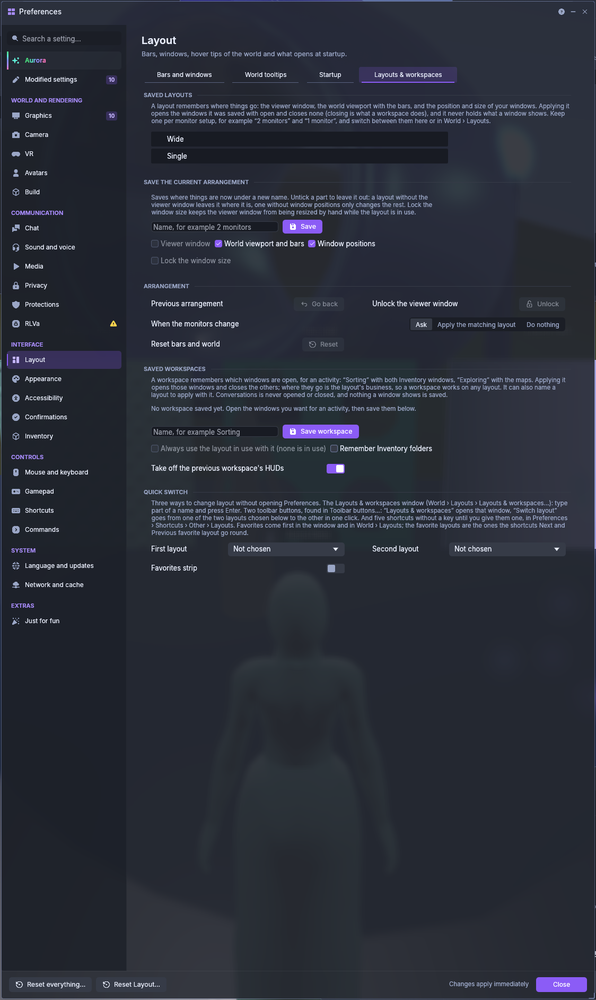

*`AURORA_DEMO_LAYOUTS=1`: two layouts, nothing selected yet.*

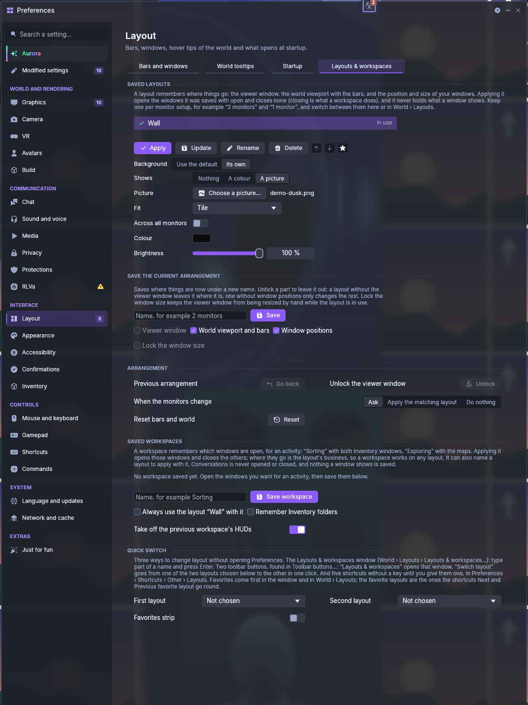

*`AURORA_DEMO_BACKGROUND=layout`: the layout "Wall" in use, selected.*

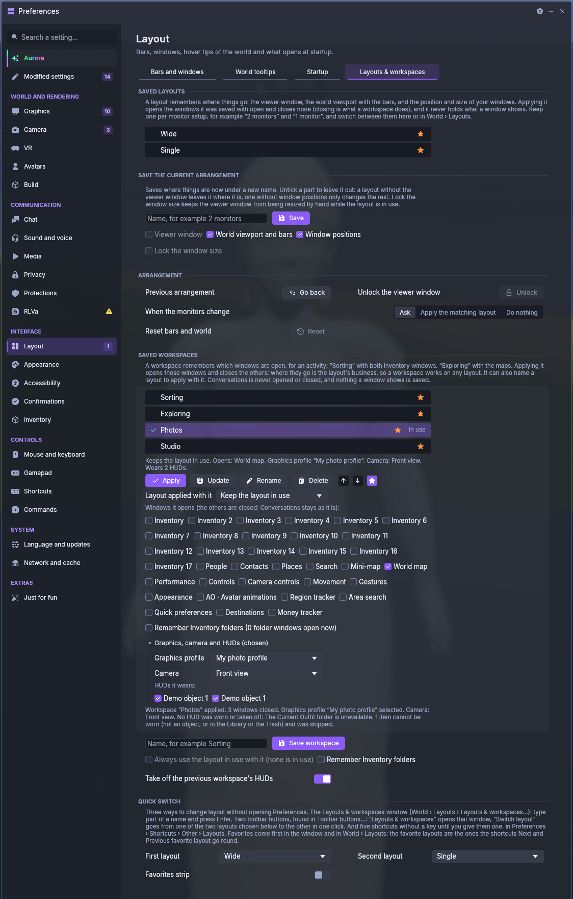

*`AURORA_DEMO_WORKSPACES=context`: a workspace with a graphics profile, a
camera and HUDs, after it was applied.*

**Names and places**

1. **Two things called "Layout".** The page *Layout* (bars, windows, hover
   tips: upstream's word for the interface) holds a tab *Layouts &
   workspaces* (saved arrangements, Folderstorm's word). Its help texts
   then say "Layout › Layouts & workspaces" (`fs-switcher-toggle-unset`),
   "Layout › Bars and windows" (`fs-background-layout-help`,
   `fs-desktop-added-on`). A reader cannot tell the page from the feature.
2. **The same name for a window and a tab.** World › Layouts ›
   *Layouts & workspaces…* opens the switcher window
   (`folderstorm/workspaces/menu.rs:268`), which has the same title as the
   Preferences tab but different abilities (it previews and saves; it
   cannot rename, delete, reorder or edit, `fs-switcher-preferences-help`).
3. **Fourth tab, after "Startup".** The biggest Folderstorm feature is the
   last tab of an upstream page, behind *Bars and windows*, *World
   tooltips* and *Startup*. Nothing in the sidebar says it exists.

**One long tab, two copies of one pattern**

4. **Five groups, three paragraphs.** The tab stacks *Saved layouts*, *Save
   the current arrangement*, *Arrangement*, *Saved workspaces* and *Quick
   switch*. Three of them open with a paragraph of 3 to 5 lines
   (`fs-layouts-intro`, `fs-workspaces-intro`, `fs-layouts-quick-intro`):
   about 450 words before any control. Upstream groups use one line, or
   none.
5. **Layouts and workspaces are two copies of the same widget** with small
   differences: list, selected entry's buttons, rename, ask before Update
   and Delete, arrows, star (`folderstorm_workspaces.rs:363–629` and
   `workspaces_group.rs:123–425`; even the rename-field code is written
   twice). But they save differently: layouts have a group of their own
   (*Save the current arrangement*, `folderstorm_workspaces.rs:104`),
   workspaces have a row inside their list's group
   (`workspaces_group.rs:80`). The two lists are not side by side; the
   *Arrangement* group sits between them.
6. **Actions hidden until a click.** With no layout in use, nothing is
   selected and the list shows bare names: no Apply, no hint that a click
   reveals the buttons (screenshot 03). The only way to learn it is the
   row's hover help.
7. **Selection is faint.** The selected line differs from the others by a
   slightly lighter fill; the line in use has a dot. Both are hand-drawn
   (`entry`, `folderstorm_workspaces.rs:270`) rather than a shared list
   row. There is no type icon, so the same line style serves layouts and
   workspaces, while the switcher and World › Layouts give each its icon
   (`layout-filled`, `app-window-filled`, `workspaces/menu.rs:22–23`).

**Hidden dependencies**

8. **The live arrangement is on another tab.** What a layout saves (world
   viewport, bars place, default background) is edited on *Bars and
   windows*; what saves it is on *Layouts & workspaces*. A layout turns
   "In use · modified" because of a change made on the other tab.
   *Reset bars and world* (`folderstorm_workspaces.rs:169`) resets settings
   of the other tab.
9. **The background lives in two places.** The default is on *Bars and
   windows* (`background.rs:41`); a layout's own is under the selected
   layout (`background.rs:298`, called from
   `folderstorm_workspaces.rs:626`).
10. **Two ways to say a workspace's layout.** When saving: a checkbox
    "Always use the layout “X” with it" (`workspaces_group.rs:637`), greyed
    with a different sentence when no layout is in use. After saving: a
    combo "Layout applied with it", default "Keep the layout in use"
    (`workspaces_group.rs:202`). Same setting, two widgets, two wordings.

**Settings mixed with actions**

11. **"Arrangement" is a grab-bag.** It holds two one-off buttons
    (*Previous arrangement*, *Unlock the viewer window*), one standing
    setting (*When the monitors change*) and a reset (*Reset bars and
    world*). The two-column flow puts Previous and Unlock side by side and
    leaves Reset alone under them (screenshot 03). *Unlock* is a disabled
    button most of the time, with no reason shown.
12. **Standing preferences are spread out.** *When the monitors change*
    (Arrangement), *Take off the previous workspace's HUDs* (inside the
    workspaces' group, after the save row, `workspaces_group.rs:86`), the
    two toggle layouts and the favorites strip (*Quick switch*). The star
    that makes a favorite is in each list's button row.
13. **These preferences are not tracked.** The rows of *When the monitors
    change*, *Favorites strip*, *Take off the previous workspace's HUDs*
    and the two toggle layouts pass `&Nothing`
    (`folderstorm_workspaces.rs:162–167`, `:196–200`;
    `workspaces_group.rs:86–97`): no "modified" dot, not listed under
    *Modified settings*, not reset by *Reset Layout…*. The module comment
    explains why for the saved layouts ("Reset this page never deletes a
    layout"), but these four are ordinary preferences. The background group
    shows it can be done (`field!(folderstorm_workspaces.background.kind)`).

**The selected workspace's editor**

14. **Long and flat.** Under a selected workspace: a summary line, seven
    buttons, the layout combo, one checkbox per switchable window (all of
    them, wrapped: a wall of boxes), *Remember Inventory folders*, and a
    folded *Graphics, camera and HUDs* (`workspaces_group.rs:418–423`). The
    windows it opens and the ones it does not look the same at a glance.

**Wording**

15. Several labels describe the mechanism rather than the result: *Previous
    arrangement* / *Go back*, *Reset bars and world*, *Unlock the viewer
    window*, *Quick switch* (which is about one toolbar button, two
    shortcuts, a window and a strip). *First layout* / *Second layout* do
    not say they are the two ends of the *Switch layout* button.

### 2.2 Layout › Bars and windows (viewport, background, desktop)

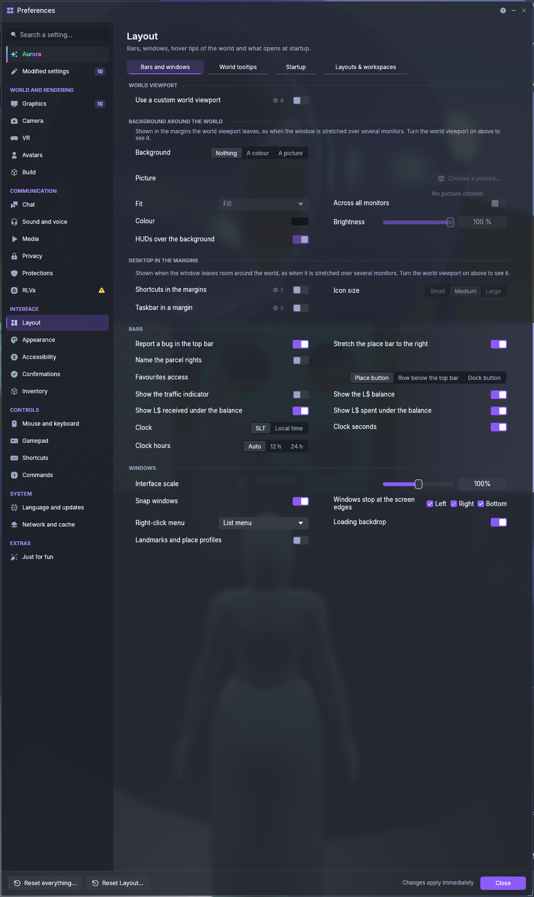

*Viewport off: two groups and nine rows that do nothing, above upstream's
own groups.*

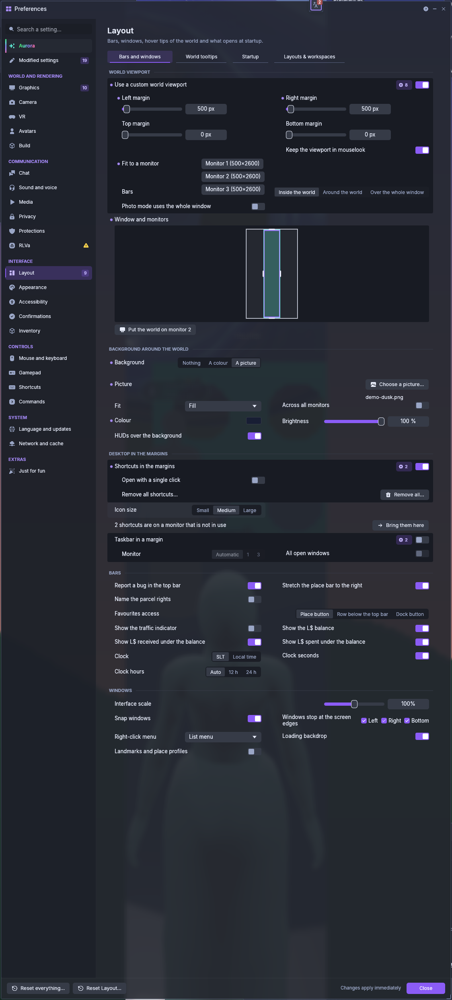

*Viewport on with the cogs open, a background picture, the desktop and its
"shortcuts on a monitor not in use" row.*

16. **Upstream's tab pushed down.** Three Folderstorm groups come first
    (`layout.rs:11`); the tab's own *Bars* and *Windows* start halfway down
    (screenshot 01), lower still when the viewport is on. The page's
    subtitle ("Bars, windows, hover tips of the world and what opens at
    startup") does not mention them.
17. **Rows that wait for another switch, but look live.** *Background
    around the world* and *Desktop in the margins* only matter while the
    world viewport leaves margins. With the viewport off they still show
    every row; each group repeats a note "Turn the world viewport on above
    to see it" (`background.rs:44`, `desktop.rs:180`). Some rows are greyed
    for other reasons (by background kind), the rest are not: the page
    does not show the dependency on the viewport at all.
18. **Two "Bars".** Where the bars go (*Inside the world / Around the world
    / Over the whole window*, `folderstorm_viewport.rs:81`) is behind the
    viewport's cog, while a group titled *Bars* (upstream's) follows two
    groups below.
19. **Sliders of 0–16384 px** for each margin (`folderstorm_viewport.rs:28–55`)
    cannot be set to a precise value by dragging; the diagram is the real
    tool. The sliders are the keyboard route (module comment), which is
    fine, but four of them in two columns dominate the open cog.
20. **Desktop group mixes two features.** The shortcuts' switch has a cog
    (single click, remove all) while their *Icon size* sits outside it,
    greyed (`desktop.rs:197`); the taskbar, another feature, follows in the
    same group with its own switch and cog.
21. **Widget drift and a layout glitch.** *Fit to a monitor* uses plain
    `ui.button` (`folderstorm_viewport.rs:141`) where upstream puts an icon
    button (`widgets::action_button`). With three monitors its buttons wrap
    into a column, and the next row (*Bars*) starts beside the last button:
    the *Bars* label sits next to "Monitor 3" and its choice is pushed into
    the right column (screenshot 02). The diagram and *Put the world on
    monitor N* repeat what the buttons do.
22. **The taskbar's monitor choice reads "Automatic 1 3"** when the world
    covers monitor 2 (`desktop.rs:248–259`): the numbers alone, with a gap,
    look like a bug. "Monitor 1", "Monitor 3" (as the desktop's own menu
    says, `fs-desktop-monitor`) or a combo would read better.

(The narrow diagram in screenshot 02 comes from the capture's made-up
500 × 2600 monitors, not from the viewer.)

### 2.3 Graphics › Smoothness › "Other Folderstorm2 windows"

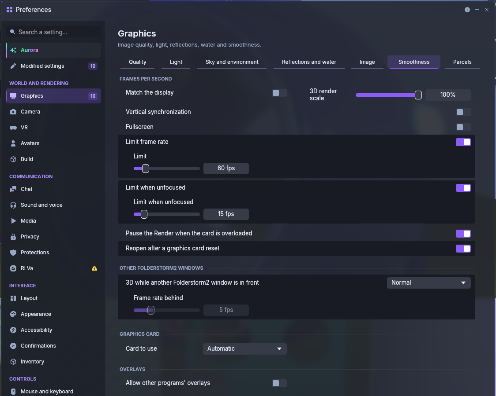

23. **Ambiguous title.** "Other Folderstorm2 windows" reads like the
    viewer's own windows (Inventory, map…). It means *other copies of the
    viewer* (one per character, `--profile`). The help explains it; the
    title should.
24. **Shared cache is not about smoothness.** *Share the main profile's
    cache* (shown only in a named profile, `folderstorm_characters.rs:35`)
    is a disk and download setting: Network and cache.

### 2.4 Chat › Nearby chat › Image uploads

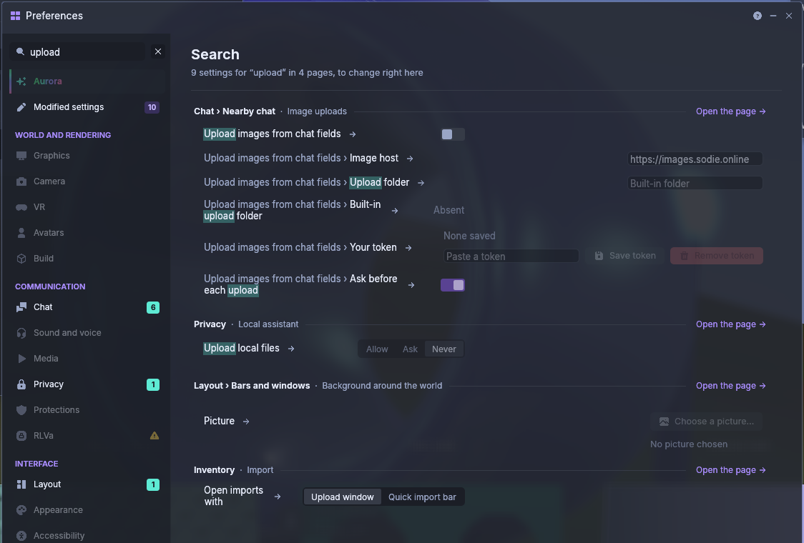

25. **Placed at the end of *Nearby chat*,** after link previews and GIFs,
    although it works in every chat field (IMs, groups). Content is clear;
    the *Built-in folder* row is a read-only status that could be part of
    the folder row's help.

### 2.5 Privacy › Local assistant

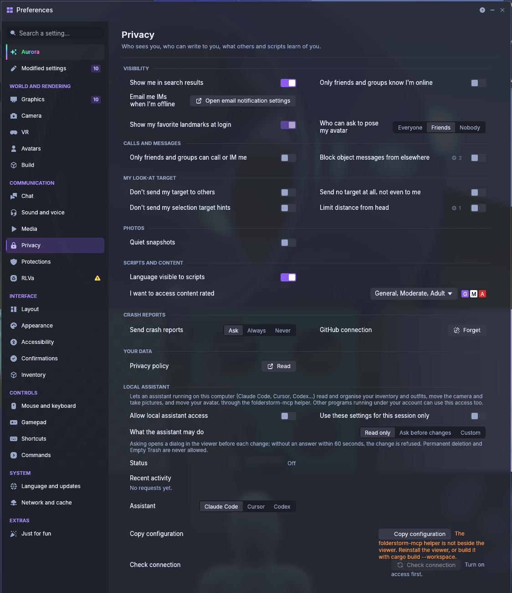

26. **A whole feature appended to an upstream page.** The group has a
    switch, a session-only switch, a preset, 17 permission rows, a status,
    the recent activity and the setup buttons (`local_assistant.rs:59–380`).
    It is longer than the rest of the Privacy page, which it ends.

### 2.6 Search

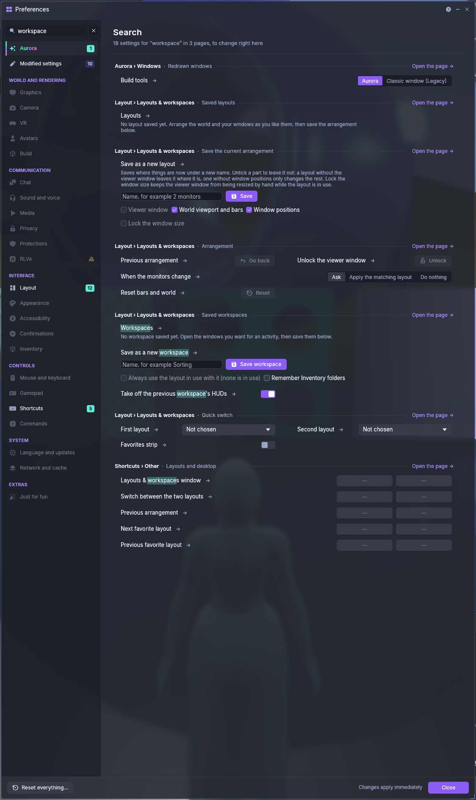

27. Search works well for the Folderstorm rows (FEATURES 1.9): "workspace"
    finds the lists and the strip. It also shows that the list rows'
    labels (*Layouts*, *Workspaces*) are only there for search
    (`section_body`), which is right.

### 2.7 The switcher window, for comparison

28. The switcher already shows the model this review recommends: one list,
    favorites first, then workspaces, then layouts, each with its icon, and
    a picture of what a layout gives on the monitors. Preferences shows
    none of that.

---

## 3. Layouts and workspaces: three options

All three keep the data model (a layout says *where*, a workspace says
*what* and may name a layout; layouts stay shared, so the toolbar toggle and
the monitor rule keep working). They differ in where things go and how the
saved entries are edited.

### Option A: one "Workspaces" page, layouts folded into it

A new sidebar page **Workspaces** under Interface, right after Layout. Four
tabs:

- **Saved**: one list of workspaces and layouts, in the switcher's order
  (favorites, workspaces, layouts) with their icons; the selected entry's
  details under it (as today, but one widget for both kinds); one *Save the
  current setup* box with *Workspace / Layout* and "It keeps:" boxes
  (the switcher's save already works this way).
- **World viewport**: today's viewport group, moved from *Bars and windows*,
  with the bars' place out of the cog.
- **Margins**: background, desktop, taskbar, behind one notice when the
  viewport is off.
- **Switching**: favorites strip, the *Switch layout* pair, *When the
  monitors change*, the HUD rule, and the three "get back" actions in one
  row.

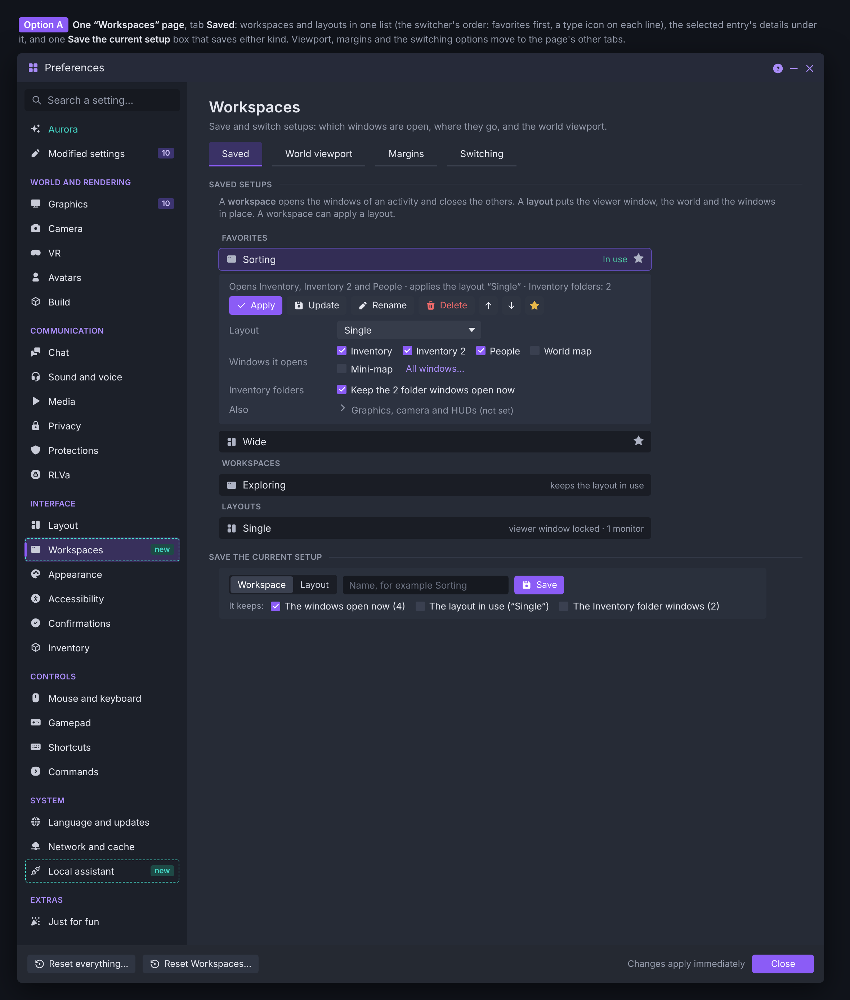
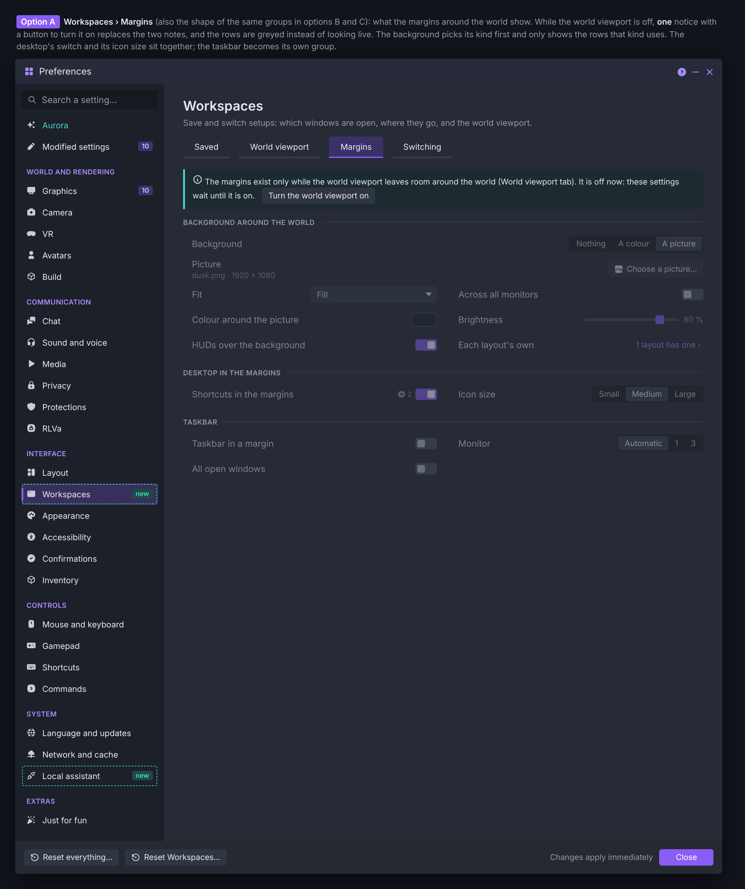
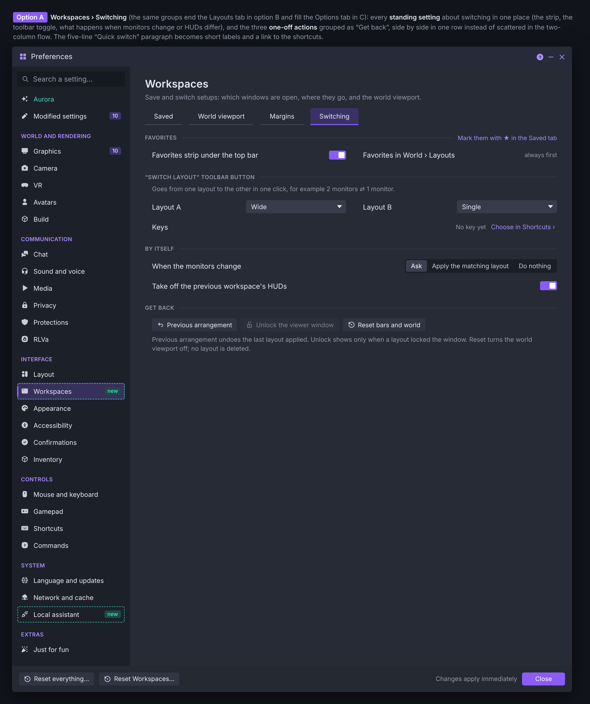

- **Pros:** one home for the whole feature family, found in the sidebar;
  upstream's Layout page goes back to upstream's content (fewer Folderstorm
  lines in `layout.rs`, an often-changed upstream file); the live
  arrangement and the saved ones are on one page; standing settings
  separate from actions.
- **Cons:** a combined list mixes two kinds that behave differently (a
  workspace closes windows, a layout does not): the icons and the summary
  line must carry that. A new `Page` touches upstream's enum and its
  matches.
- **Upstream hooks:** `ui/options.rs`: one `Page` variant plus one arm in
  each of `ALL`, `key`, `name`, `about`, `icon` (about 6 marked lines);
  `pages.rs`: `tabs` and `draw` arms (2). Removed: `layout.rs:11`,
  `layout.rs:188`, `pages.rs:90`. Net about +5 hook lines, all one-liners.
- **Size:** medium. Mostly moving existing groups into a new page module
  (`pages/folderstorm_workspaces/` gains `saved.rs`, `viewport.rs`,
  `margins.rs`, `switching.rs`); one shared list-and-detail widget replaces
  the two copies; help texts that name "Layout › …" change in en/fr/ja;
  tests and `docs/TESTING.md` move from `layout/3` and `layout/0` to
  `workspaces/<tab>`. Two PRs: the page move, then the merged list.

### Option B: keep the Layout page, untangle it

No new page. The Layout page gets three Folderstorm tabs instead of one
plus three groups on *Bars and windows*:
*Bars and windows* (upstream only) · **World viewport** (viewport, margins'
background, desktop, taskbar) · **Layouts** · **Workspaces** · *World
tooltips* · *Startup*.

- *Layouts*: one-line intro; the list with the layout in use (or the first)
  selected by default; its viewer window and background; a save box; a
  *Switching layouts* group (the toggle pair, *When the monitors change*);
  *Get back* (the three actions in a row).
- *Workspaces*: the same list widget; one *Layout* row with the same words
  at save time and after; windows it opens first, the rest behind *All
  windows…*; *When switching* (HUD rule, favorites strip).
- Cross-links between the three tabs (`Cx::link` already exists).

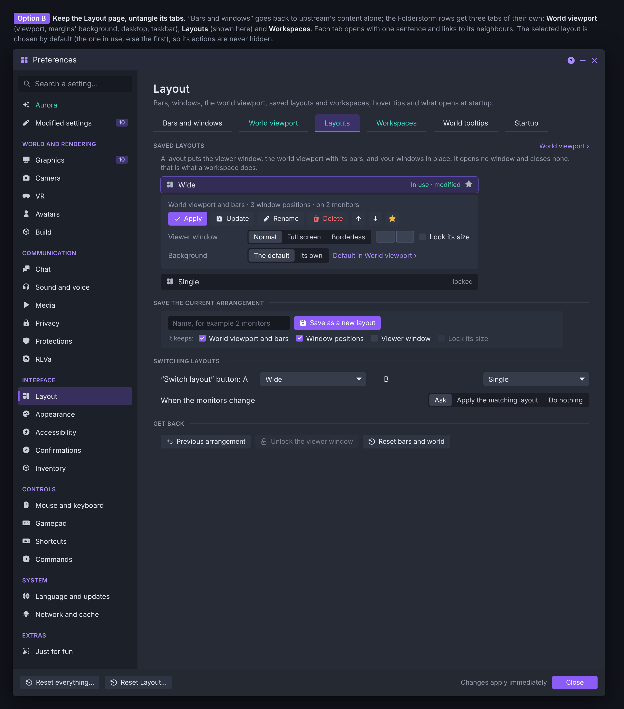
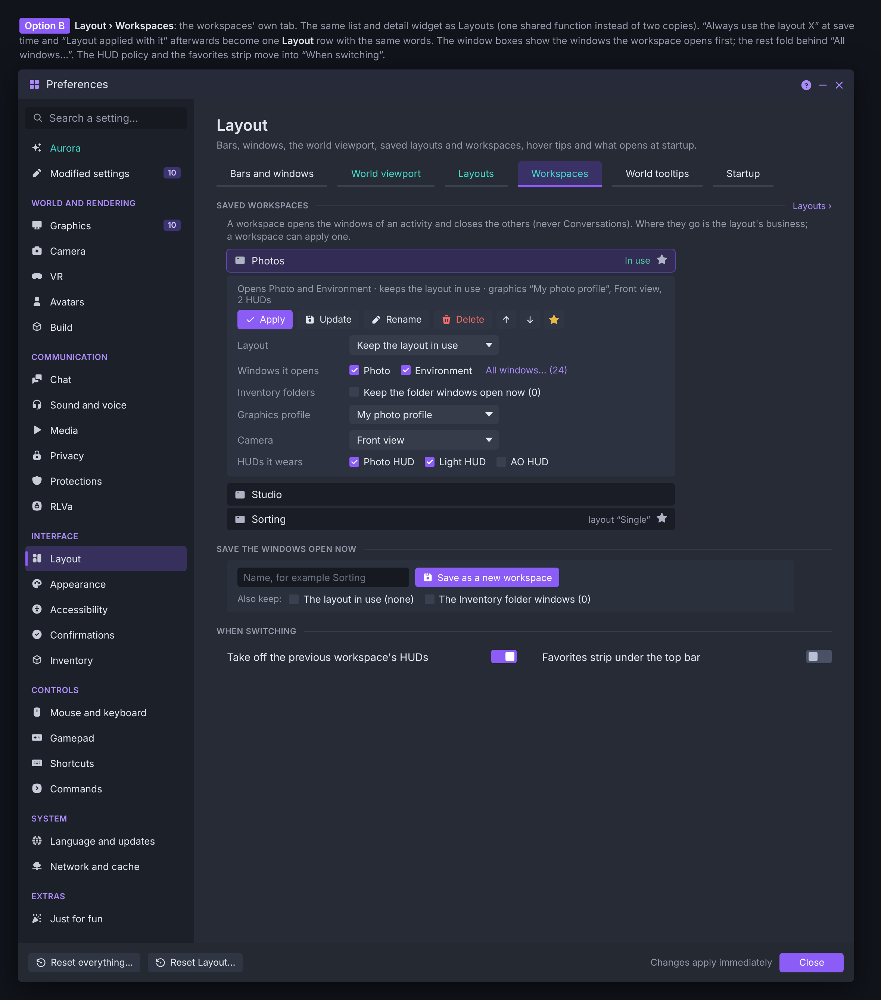

- **Pros:** smallest change and smallest risk; no change to upstream's page
  list; each tab has one subject; upstream's *Bars and windows* is restored.
- **Cons:** the feature stays hidden inside an upstream page (no sidebar
  entry; six tabs on Layout, as many as Graphics has); "Layout" (page) vs
  "Layouts" (tab) remains, softened by the tab names.
- **Upstream hooks:** `pages.rs` `tabs`: 3 entries instead of 1;
  `layout.rs` `page`: 3 match arms instead of 1, and the hook at
  `layout.rs:11` removed. About +3 one-line hooks, all in the files that
  have them today.
- **Size:** small. Split `folderstorm_workspaces::page` into two tab
  functions, move three groups to a new tab function, share the list
  widget, shorten the intros, track the four preferences (§ 2.1 point 13).
  One PR.

### Option C: master–detail, each workspace shows its layout

One **Workspaces** page as in A, but its *Saved* tab is a master–detail
editor: a fixed list on the left (workspaces, layouts, *+ New from
current…*), the selected entry's editor on the right.

- A **workspace**'s editor: windows it opens (a grid), Inventory folders,
  *Where they go*: the layout combo and, beside it, a card for that layout
  (its monitors, window mode, viewport, background) with *Open this layout*;
  then graphics, camera and HUDs.
- A **layout**'s editor: viewer window (mode, monitors, lock), a picture of
  its saved viewport and bars (the switcher's preview picture reused),
  background (default or its own), and **used by** (which workspaces apply
  it; whether the toolbar toggle uses it): a link the current page never
  shows.
- *+ New from current…* opens the save form in the right pane.
- The other tabs (*World viewport*, *Margins*, *Switching*) as in A.

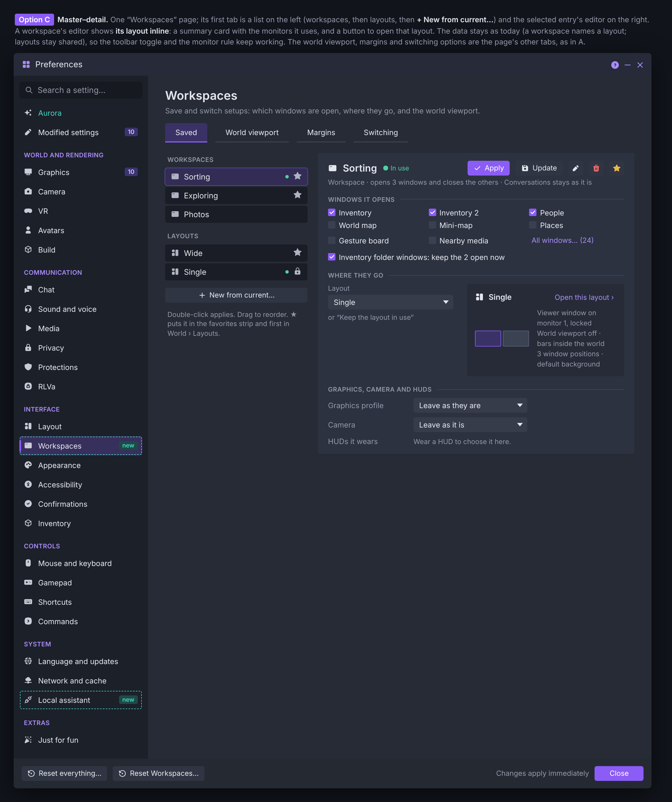
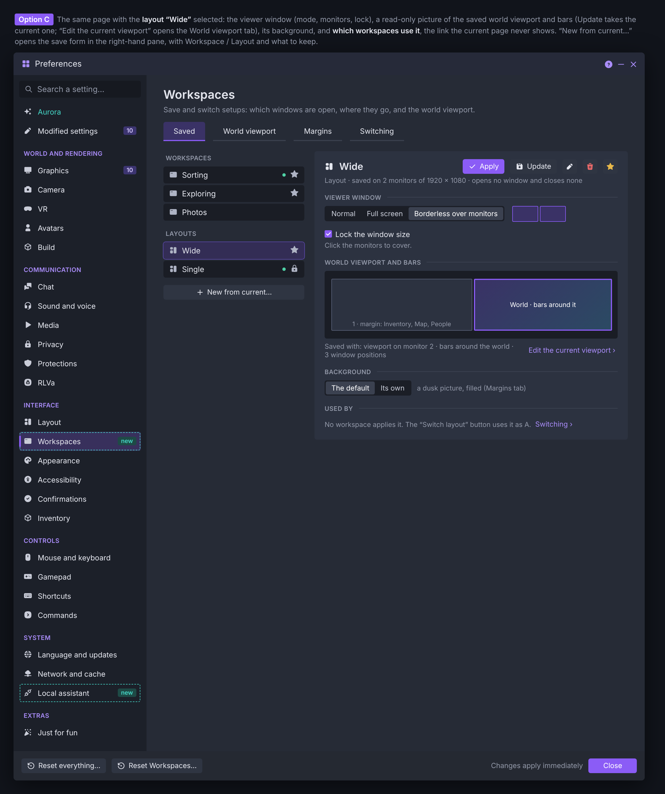

- **Pros:** the clearest model: what a workspace does and where its windows
  go are read in one place; scales to many entries (the store allows
  dozens); the detail pane has room for the preview picture and the "used
  by" link; matches the switcher's list.
- **Cons:** the most work; a custom two-pane widget inside a `Cx` row
  (`section_body`, as the lists already are), so search and *Modified
  settings* reach its rows only through their labels; the pane needs care
  at the window's minimum width (640 px: the list then stacks above the
  editor). "Each workspace holds its layout" is shown, not stored: making
  a workspace own a private copy of a layout would break the shared uses
  (toggle, monitor rule) and is not proposed.
- **Upstream hooks:** as A.
- **Size:** large. A's page move, plus a new master–detail widget (about
  1–1.5k lines with tests), plus reuse of `workspaces/preview.rs` for the
  layout picture. Three PRs: page move, master–detail for layouts and
  workspaces, preview and "used by".

### Side by side

| | A: one page, sections | B: untangle in place | C: master–detail |
|---|---|---|---|
| Sidebar entry | Yes | No | Yes |
| Upstream *Bars and windows* restored | Yes | Yes | Yes |
| Live viewport next to saved layouts | Same page | Neighbouring tab | Same page, with picture |
| One widget for both kinds | Yes | Yes | Yes |
| Shows which workspaces use a layout | No | No | Yes |
| Upstream hook lines (net) | about +5 | about +3 | about +5 |
| Size | Medium (2 PRs) | Small (1 PR) | Large (3 PRs) |

---

## 4. Smaller proposals for the other pages

1. **World viewport** (wherever it lands): take *Bars* (inside / around /
   over the window) out of the cog and name it "Bars around the world"; keep
   the four margin sliders behind the cog but as number fields (0–16384 px
   is too wide for a slider); make *Fit to a monitor* icon buttons
   (`widgets::action_button`, `device-desktop-filled`).
2. **Background and desktop**: one notice when the viewport is off, with a
   *Turn the world viewport on* button, and the rows greyed (`cx.greyed`)
   instead of two notes over live-looking rows; background shows only the
   rows of the chosen kind (`cx.conditional`, which keeps them in search);
   *Icon size* goes behind the shortcuts' cog; the taskbar gets its own
   group. Mockup: A2.
3. **"Other Folderstorm2 windows"** → title "Several characters on one PC"
   (still built from `folderstorm_brand::PRODUCT` in the help); move *Share
   the main profile's cache* to Network and cache (a `cx.link` row from
   here if it should stay findable).
4. **Image uploads** → its own tab of Chat (*Images*, with *Link previews*
   and *GIFs* if upstream agrees; otherwise just the uploads), or at least
   a note that it applies to every chat field. Fold *Built-in folder* into
   the folder row's help.
5. **Local assistant** → its own page in the System section, with a one-line
   `cx.link` row left in Privacy ("Local assistant: off › settings"). Same
   rows, same code; one more `Page` variant (or part of A's hook set).
6. **Gesture boards, nearby media, Inventory tabs and windows**: no page.
   Their options belong to their windows, as upstream does for its tool
   windows. If one of them later gets a real preference, it joins the
   upstream page of its topic (Inventory, Media) as one marked row, like
   outfit safety.
7. **Track the standing preferences** (§ 2.1 point 13) with `field!` paths
   into the store, so that they show their modified dot, appear in
   *Modified settings* and reset with the page; the saved layouts and
   workspaces stay untracked.
8. **Short intros**: one sentence per group, the rest in the rows' help.

---

## 5. Proposed order and grouping

Topic first, not fork first: a "Folderstorm" sidebar section would collect
unrelated settings (multi-monitor, chat, an MCP bridge) and put the
product name in upstream code. Proposed (new pages marked ★):

| Section | Pages (Folderstorm content in bold) |
|---|---|
| World and rendering | Graphics (*Smoothness*: **Several characters on one PC**), Camera, VR, Avatars, Build |
| Communication | Chat (**Image uploads**, own tab or end of Nearby chat), Sound and voice, Media, Privacy (link to Local assistant), Protections, RLVa |
| Interface | Layout (upstream only), ★ **Workspaces** (*Saved* · *World viewport* · *Margins* · *Switching*), Appearance, Accessibility, Confirmations, Inventory (**outfit safety** row) |
| Controls | Mouse and keyboard, Gamepad, Shortcuts (**layouts and desktop keys**, under *Other*), Commands |
| System | Language and updates, Network and cache (**shared cache** in a named profile), ★ **Local assistant** |
| Extras | Just for fun |

Inside ★ Workspaces, the tab order follows use: *Saved* (what you do most),
*World viewport* (set once), *Margins* (decoration), *Switching* (rules).

---

## 6. Recommendation

**Option A's page, built in two steps, with C's editor as the second step.**

1. **First PR (A, page move):** add the *Workspaces* page with its four
   tabs, move the viewport, background and desktop off *Bars and windows*,
   split *Switching* out, track the four preferences, shorten the intros.
   This fixes most findings (1, 3, 4, 8, 9, 11, 12, 13, 16–22) for a medium
   effort and about five one-line upstream hooks, and gives the feature a
   sidebar entry.
2. **Second PR (C, master–detail Saved tab):** replace the two copied list
   widgets with one master–detail editor, with the layout card inside a
   workspace and "used by" inside a layout (findings 5, 6, 7, 10, 14). If
   that proves too heavy, A's single list with inline details (mockup A1)
   is the fallback: it already merges the two copies.

Option B is the right choice only if the human wants no new sidebar entry
or no change to upstream's page enum; it is cheap and solves the tangle, but
leaves the feature hidden.

Questions for the human:

- Page name: *Workspaces* (the human's word, matching the switcher's
  "Layouts & workspaces"), or something that also says "monitors"
  (*Screen & workspaces*)? Search finds "viewport" and "dual monitor"
  either way (FEATURES 1.9).
- Should the switcher window keep its own *Save new…* once Preferences has
  a good save form? (It is handy from the keyboard; keeping both is fine
  if they use the same words.)
- Local assistant as its own page: yes or no? It is independent of the
  rest and can be done any time.

---

## 7. How the pictures were made

Captures (`preferences-review/screens/`), demo mode under Xvfb with
lavapipe, one run each, from the test branch built with
`cargo +1.100.0 build --profile ci -p aurora-viewer`, `AURORA_CAPTURE` at
frame 90 to 260:

| File | Variables |
|---|---|
| `01-bars-and-windows-viewport-off.png` | `AURORA_DEMO_OPTIONS=layout/0` |
| `02-bars-and-windows-all-on.png` | `AURORA_DEMO_OPTIONS=layout/0:cogs AURORA_DEMO_BACKGROUND=1 AURORA_DEMO_DESKTOP=unused AURORA_DEMO_MONITORS=500x2600,500x2600,500x2600` |
| `03-layouts-tab-seeded.png` | `AURORA_DEMO_LAYOUTS=1 AURORA_DEMO_MONITORS=750x2000,750x2000` |
| `04-layouts-tab-selected.png` | `AURORA_DEMO_BACKGROUND=layout AURORA_DEMO_OPTIONS=layout/3` |
| `05-workspaces-context.png` | `AURORA_DEMO_WORKSPACES=context` |
| `06-graphics-smoothness.png` | `AURORA_DEMO_OPTIONS=graphics/5` |
| `07-search-upload.png` | `AURORA_DEMO_OPTIONS=chat:search=upload` |
| `08-privacy-local-assistant.png` | `AURORA_DEMO_OPTIONS=privacy:local-assistant` |
| `09-search-workspace.png` | `AURORA_DEMO_OPTIONS=layout:search=workspace` |
| `10-switcher.png` | `AURORA_DEMO_WORKSPACES=1` (window at its real size) |

The Preferences window was made taller for the full-tab captures by a
local, uncommitted change (its default 1120 × 720 replaced through an
environment variable); `11-layouts-default-size.png` shows the tab at the
real size, as the human sees it first. A fake media-plugin folder kept the
"Download web and media support?" card away.

Mockups (`preferences-review/mockups/`): `*.html` with `prefs.css`, Tabler
icons inlined from `assets/tabler-icons/`, Inter from
`crates/aurora-viewer/assets/fonts/`; open them from the repository so the
font paths resolve. Rendered with Playwright/Chromium, device scale 2.
